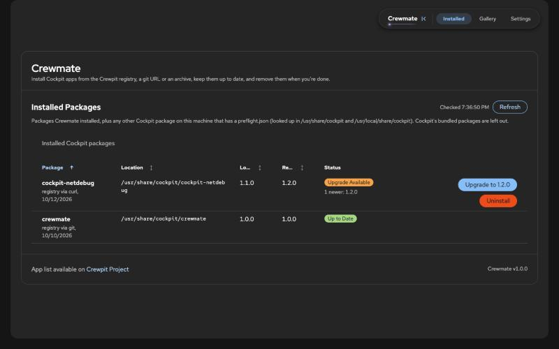
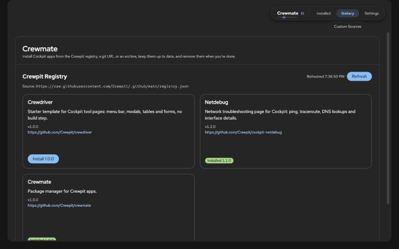
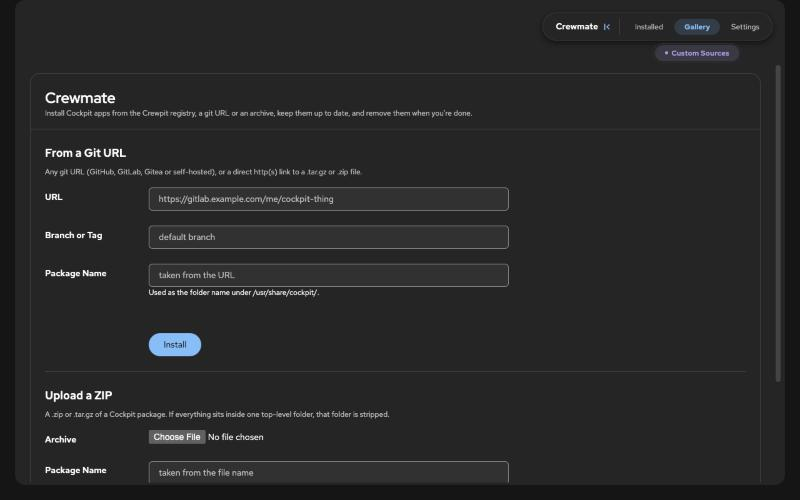
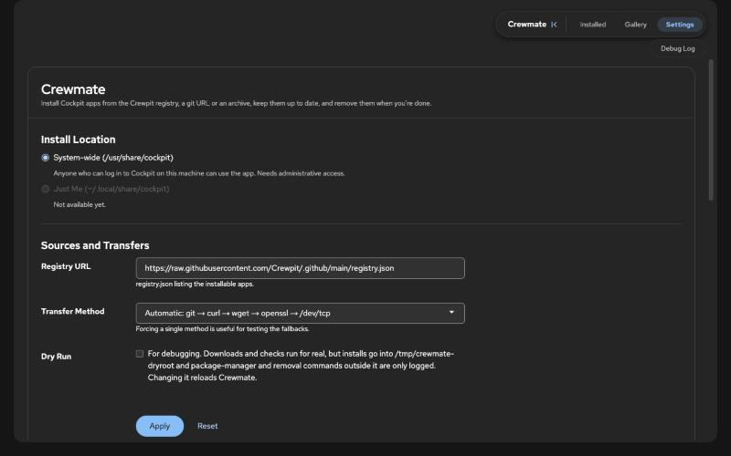

# Crewmate

A [Cockpit](https://cockpit-project.org/) tool page that installs, upgrades and removes other Cockpit apps. Pick one from the Crewpit registry, point it at any git URL, or upload a `.zip` / `.tar.gz`. Crewmate downloads it to a staging folder, reads its `manifest.json` and `preflight.json`, checks the requirements, and copies it into `/usr/share/cockpit`. The previous version is kept as a rollback copy.

Requires no build step: just static HTML/CSS/JS plus one POSIX shell helper, dropped into a Cockpit package directory. Built from [Crewdriver](https://github.com/Crewpit/crewdriver).

## Screenshots

| Installed | Gallery |
| --- | --- |
|  |  |

| Custom Sources | Settings |
| --- | --- |
|  |  |

## Pages

- **Installed** - packages Crewmate installed, plus other Cockpit packages on the machine that ship a `preflight.json`. Shows whether each is up to date, has an upgrade, or is missing on disk, with Upgrade and Uninstall buttons.
- **Gallery** - apps listed in the registry's `registry.json`. Refresh re-reads it, which doubles as the upgrade check.
- **Gallery / Custom Sources** - install from a git URL (optional branch or tag) or an uploaded archive.
- **Settings** - registry URL, forced transfer method, Dry Run.
- **Settings / Debug Log** - every command Crewmate runs and everything it prints.

## How an install works

1. Check the host: transfer tools, Cockpit version, package manager.
2. Download into `/tmp/crewmate.XXXXXX/<package>` (private, random name). Transfer methods are tried in order: `git`, `curl`, `wget`, `openssl s_client`, `bash /dev/tcp` (plain `http://` only).
3. Read `manifest.json` and `preflight.json`. A package without `preflight.json` is refused.
4. Preflight: `cockpitMin` blocks the install on an older Cockpit, and each dependency is looked up with `command -v` (plus a minimum version when set). Missing dependencies can be installed with the host's package manager if you choose to.
5. Copy to `/usr/share/cockpit/<package>`, move the old version to `/var/lib/crewmate/backup/<package>`, record it in `/etc/cockpit/crewmate.json`, then offer a tab reload so the sidebar picks it up.

Settings and the install record live in `/etc/cockpit/crewmate.json`, created on first save. **Dry Run** keeps everything under `/tmp/crewmate-dryroot`: downloads and checks are real, installs go to the fake root, and package-manager and removal commands are only logged.

Crewmate can upgrade itself: it ships a `preflight.json`, so once it is listed in the registry the Installed page offers an upgrade like for any other package. It never offers to uninstall itself.

## Setup checks on load

Every time the page opens, Crewmate runs a read-only check (`crewmate.sh check`) and writes nothing to the system. It looks for:

- **Files Cockpit doesn't serve yet.** Cockpit fixes a package's file list when you log in, so a file added afterwards answers 404. Crewmate lists the files changed since your session started, requests each one, and if any is missing it offers to log you out (30 second countdown, with Log Out Now and Not Now). A warning stays on the page if you decline.
- **Unreadable files.** Cockpit serves files as the logged-in user, so files that others can't read fail to load. Fix with `chmod -R a+rX` on the folder.
- **A fresh machine.** With no settings file, no install record and no other Crewpit packages, a short welcome notice appears, including a reminder to turn on administrative access if it is off.

The settings file, `/etc/cockpit`, and `/var/lib/crewmate` are only created when you first save a setting or install a package.

## Layout

- `manifest.json`, `preflight.json` - package metadata and requirements
- `index.html`, `index.js` - page markup, registry, inventory, install modal, settings
- `crewmate.sh` - host-side helper (POSIX sh), talks to `index.js` with `@log` / `@kv` lines
- `functions.js` - reusable `window.App` helpers from Crewdriver (menu, modals, alerts, tables, forms)
- `theme.js` - keeps the dark/light theme in sync with the shell
- `index.css`, `cockpit-glue.css` - page styles and layout glue for an embedded Cockpit page
- `vendor/patternfly/` - vendored PatternFly CSS

## Installing

> [!IMPORTANT]
> **The first install of Crewmate has to be done manually**, by copying the files onto the machine as described below. Once it is running, every later change and upgrade can be done from Crewmate itself, through its own Installed page.

The target machine needs Cockpit 175 or newer and at least one of `git`, `curl`, `wget`, `openssl` or `bash` for downloads. `preflight.json` lists no mandatory commands.

Get the code, then copy it into `/usr/share/cockpit/crewmate` on the machine you want to manage packages on:

```bash
git clone https://github.com/Crewpit/crewmate
cd crewmate
```

With `rsync` (needs `rsync` on both ends):

```bash
rsync -rvh --exclude .git --exclude screenshots ./ root@<host>:/usr/share/cockpit/crewmate/
```

Or with `scp`:

```bash
scp -r . root@<host>:/usr/share/cockpit/crewmate
```

If you are already on the target machine, `cp -r . /usr/share/cockpit/crewmate` as root does the same.

Reload Cockpit in the browser and **Crewmate** shows up in the sidebar under Tools. Cockpit lists a package's files when you log in, so after adding a new file (not just editing one), log out and back in or it will 404.

From here on, upgrades are self-service: open **Installed** and press **Refresh**. When the registry lists a newer Crewmate, an **Upgrade** button appears on its row. Pulling the repository and copying the files over again still works if you prefer it.

## Developing a Crewpit App Package

Any Cockpit package can be installed by Crewmate as long as it follows a few rules. The easiest start is [Crewdriver](https://github.com/Crewpit/crewdriver), a template with the menu bar, theme sync, modals, tables and forms already in place.

### 1. Package layout

The package is a plain folder of static files with no build step. Crewmate installs it into `/usr/share/cockpit/<name>`, so the folder name becomes the package name. Keep it short, lowercase and hyphenated (letters, digits, `.`, `_`, `+` and `-` only, never starting with a dot). Two files must sit in the package root:

- `manifest.json` - the normal Cockpit manifest. Without it the folder is not a Cockpit package and the install stops.
- `preflight.json` - Crewmate's own metadata. A package without it is refused, even if the file is just `{}`.

If the files sit inside a single wrapper folder (the `repo-main/` that GitHub archives add), Crewmate strips it.

### 2. `preflight.json`

```json
{
  "cmSchema": 1,
  "version": "1.0.0",
  "issues": "https://github.com/<owner>/<repo>/issues",
  "cockpitMin": 175,
  "dependencies": [
    { "name": "dd", "package": "coreutils" },
    { "name": "ps", "package": { "apt-get": "procps", "dnf": "procps-ng" } }
  ]
}
```

| Field | What it does |
| --- | --- |
| `cmSchema` | Format version. Always `1` for now. A newer value blocks the install on an older Crewmate. |
| `version` | The version Crewmate records as installed and compares with the registry to offer upgrades. Bump it on every release. |
| `issues` | Link shown to the user when a check fails. |
| `cockpitMin` | Blocks the install on an older Cockpit. Keep it equal to `requires.cockpit` in `manifest.json`. |
| `dependencies` | Every host command the page spawns. Each is checked with `command -v` before the install. |

A dependency can also carry:

- `min` - minimum version. Crewmate runs `<name> --version` and compares the first version number it finds.
- `probe` - a different command that prints the version, when `--version` does not work. It runs unprivileged with a 5 second limit.
- `package` - the distro package that provides the command, when the names differ. A string, or a map per package manager (`apt-get`, `dnf`, `yum`, `zypper`, `apk`, `pacman`).
- `docs` - URL with install instructions, shown when the distro has no package for it.

Missing or outdated dependencies are shown before the install, and the user can let Crewmate install them with the host's package manager. Anything not packaged by the distro points to `docs`. Update this list whenever the page starts calling a new command.

### 3. Test it

Install it from a git URL or an uploaded archive on **Gallery / Custom Sources**. Turn on **Dry Run** in Settings first if you want to check the flow without touching `/usr/share/cockpit`. The Debug Log shows every command and result. Also try it with a missing dependency and with a package that has no `preflight.json`, to see how the failure reads.

### 4. Get it into the registry

The Gallery reads a `registry.json`, by default the one in the Crewpit `.github` repository:

```json
{
  "cmSchema": 1,
  "updated": "2026-10-17",
  "apps": [
    {
      "name": "Crewdriver",
      "version": "1.0.0",
      "href": "https://github.com/Crewpit/crewdriver",
      "description": "Starter template for Cockpit tool pages."
    }
  ]
}
```

`href` is the repository URL (GitHub and GitLab work without git on the host), `version` should match the one in your `preflight.json`, and `description` is the text on the Gallery card. The package name is taken from the last part of `href`.

Once you have read this section and your package installs cleanly from a git URL, you can request to have it added to the registry by opening an issue on the [Crewpit `.github` repository](https://github.com/Crewpit/.github/issues) with the repository link and a one-line description. After it is listed, bumping `version` in `preflight.json` and in the registry is all it takes for users to see an upgrade.
